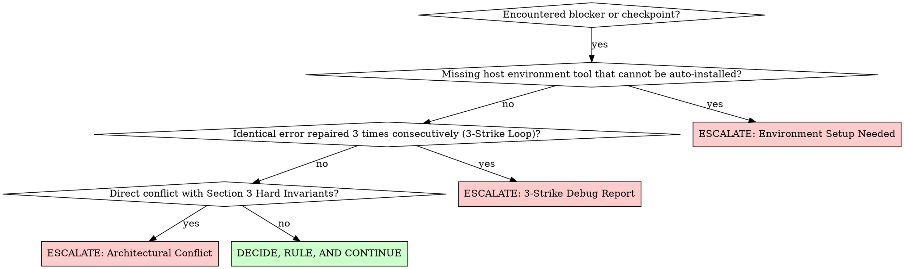
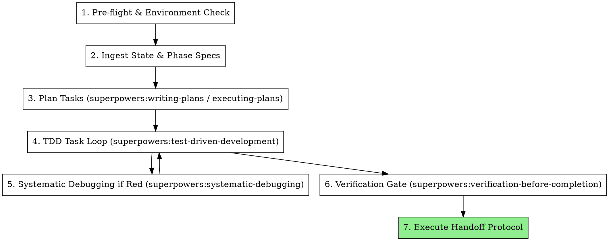

# Executing Autonomous Phase

## Overview

Execute a complete development phase from start to finish without intermediate human prompts, bounded strictly by the Autonomous Constitution and powered by Superpowers skills.

**Core principle:** The specifications and tests are the authority. Execute every task continuously, verify with real evidence, and escalate only when facing a hard circuit breaker.

---

## When to Use

### Use When:
- Assigned a numbered development phase (e.g., `PHASE_1`, `PHASE_2`, etc.) defined in project specifications.
- Instructed to work in full autonomous mode ("Zero-Interruption Protocol").
- The phase has clear deliverables, verification criteria, and handoff protocols in `.agent/` or project docs.

### When NOT to Use:
- Open-ended exploratory research with no deliverables or acceptance criteria.
- Small one-off bug fixes outside of an active phase roadmap (use `superpowers:systematic-debugging` directly).
- Refactoring tasks that do not belong to the current phase target.

---

## The Escalation Circuit Breakers (Allowed Stops)

The agent **MUST NOT** pause to ask trivial questions (*"Should I proceed?"*, *"May I create this file?"*, *"Which library do you prefer?"*).

The agent is **ONLY PERMITTED TO STOP AND PROMPT THE USER** under exactly three conditions:

### Condition 1: Environment Installation Checkpoint
- **Trigger:** A required host tool, compiler, or SDK (e.g., missing specific JDK version, Docker daemon not running, global package requiring root/sudo) is absent, cannot be installed via available package managers (`winget`, `curl`, `npm`, `mvn`) within the current session, or requires interactive user authorization.
- **Escalation Output:**
  1. The exact tool and command that failed.
  2. The manual command or installation link the user must run.
  3. The verification command to re-test after user completes setup.

### Condition 2: 3-Strike Fix Loop
- **Trigger:** Applying `systematic-debugging` to fix the exact same compilation, test, or runtime error for the **third consecutive attempt** without resolving it.
- **Escalation Output:**
  1. **Root Error:** Full error message and stack trace.
  2. **Attempted Fixes:** Summary of 3 distinct approaches tried and why each failed.
  3. **Proposed Solutions:** 2 concrete alternative architectural paths for the user to select.

### Condition 3: Critical Architectural Conflict
- **Trigger:** Specifications or requirements directly contradict the Hard Architectural Invariants (Section 3 of `.agent/00_CONSTITUTION.md`) and cannot be resolved through safe technical deduction.
- **Escalation Output:**
  1. The specific invariant being violated.
  2. The conflicting requirement found in the spec.
  3. Two safe resolution options.

---

## The Autonomous Phase Execution Lifecycle

### Step 1: Pre-flight & Environment Verification
Before touching code, verify all compilers, package managers, and runtimes required by the phase:
- Inspect versions (`java -version`, `mvn -v`, `node -v`, `npm -v`, `git --version`, etc.).
- If a tool is missing, attempt non-interactive automated bootstrap first (e.g., download portable zip, add to session `$env:Path`).
- Escalate **ONLY** if automatic provisioning is blocked.

### Step 2: Ingest State & Phase Specifications
Read the three foundational control files:
1. `.agent/00_CONSTITUTION.md`: Absorb hard invariants and constraints.
2. `.agent/01_PROJECT_STATE.md`: Identify the current `ACTIVE PHASE` and previously established contracts.
3. `.agent/02_PHASE_ROADMAP.md`: Read the deliverables and mandatory verification commands for the current phase.

### Step 3: Autonomous Task Decomposition
**REQUIRED SUB-SKILL:** Load `superpowers:executing-plans`.
- Break down the phase deliverables into discrete tasks (data models, interfaces, core logic, serialization, integration tests).
- Order tasks so that dependencies are satisfied linearly.

### Step 4: The TDD Implementation Loop
**REQUIRED SUB-SKILL:** Load `superpowers:test-driven-development`.
For every deliverable:
1. **RED:** Write the automated test first (JUnit 5 for backend, Vitest/TypeScript for frontend). Run it. Witness it fail.
2. **GREEN:** Write minimal production code to satisfy the test. Run it. Witness it pass.
3. **REFACTOR:** Clean up code, remove duplication, and preserve invariants.

### Step 5: Autonomous Error Resolution
**REQUIRED SUB-SKILL:** Load `superpowers:systematic-debugging`.
When encountering build errors or test failures:
- Read full compiler diagnostics and stack traces. Never guess or patch blindly.
- Track attempt counter:
  - Attempt 1: Investigate root cause and apply targeted fix.
  - Attempt 2: If still failing, re-evaluate assumptions and apply deeper structural fix.
  - Attempt 3: If still failing on the exact same error, trigger **Escalation Circuit Breaker 2 (3-Strike Loop)**.

### Step 6: Full Verification Gate
**REQUIRED SUB-SKILL:** Load `superpowers:verification-before-completion`.
Before claiming phase completion:
- Run the full project test command from terminal (`mvn clean test` for backend, `npm run typecheck && npm run build` for frontend).
- Verify `0 Failures, 0 Errors, Exit Code 0`.
- Capture exact command and stdout/stderr as proof.

### Step 7: Handoff Execution
Execute the two mandatory handoff operations defined in `.agent/03_HANDOFF_PROTOCOL.md`:
1. **Update `.agent/01_PROJECT_STATE.md`:**
   - Mark `[x]` on the completed Phase.
   - Advance `Active Phase` to the next phase (`PHASE_N` $\rightarrow$ `PHASE_N+1`).
   - Append newly established files, classes, and contracts into Section 2.
   - Update Section 3 with next phase goals.
2. **Write `.agent/handoffs/phase-[N]-handoff.md`:**
   - Follow the canonical 15-line template.
3. **Commit changes:**
   - Commit changes cleanly to git.

---

## Rationalization Table & Red Flags

| Rationalization | Reality | Autonomous Action |
| :--- | :--- | :--- |
| "Let me check with the user before creating these 5 classes." | User chose autonomous execution to avoid micro-management. | Create all 5 classes and test them immediately. |
| "The plan looks slightly ambiguous, I'll stop and ask." | The engineer is empowered to make rulings that conform to the spec. | Make the decision, record the ruling in the handoff, and continue. |
| "The test failed once, I'll ask the user what to do." | Debugging is the agent's job. | Use `systematic-debugging`. You have 3 strikes before escalating. |
| "I'll ask user if they want me to run the build." | Verification is mandatory, not optional. | Run the build command directly in the shell. |
| "Maven is missing on PATH, I must ask user to install it." | Check if portable binary can be downloaded or added to PATH. | Auto-bootstrap tool. Only escalate if system permissions block it. |
| "Tests passed earlier, so phase is complete." | Evidence must be fresh and complete. | Run full clean test suite before writing handoff. |

---

## Red Flags - STOP and Correct Course

If you find yourself about to emit any of the following phrases, **STOP**:
- ❌ *"Would you like me to continue with Task 2?"*
- ❌ *"Is this implementation okay before I move on?"*
- ❌ *"Shall I write the test now or do you prefer to review?"*
- ❌ *"I'm about to edit file X, please confirm."*

**Correction:** Delete the question. Check the spec, write the test, implement the code, run the verification, and keep moving.
